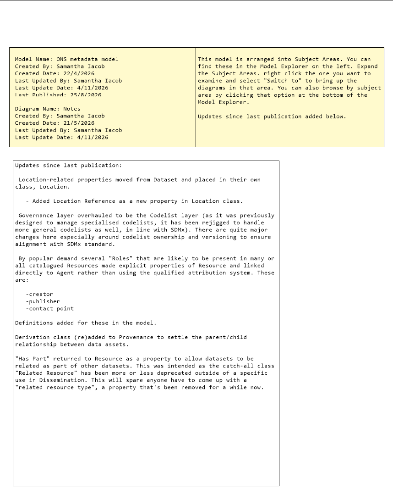
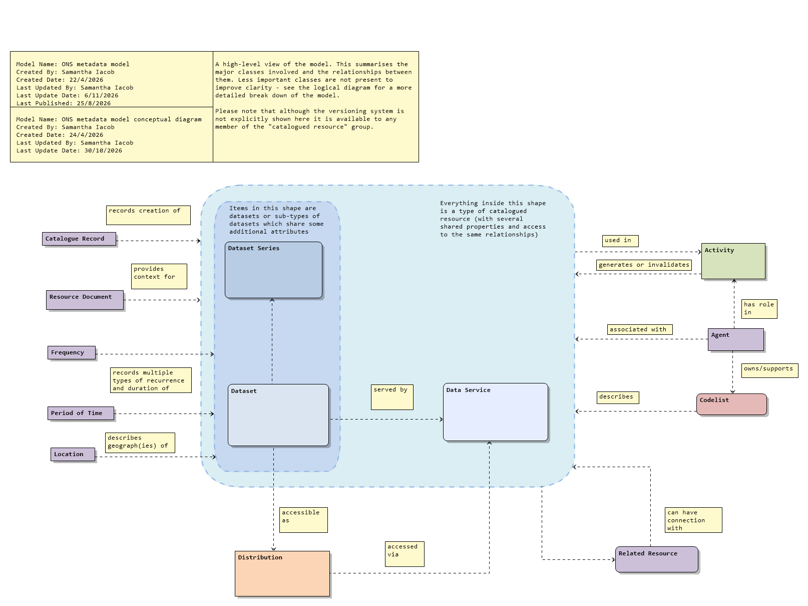
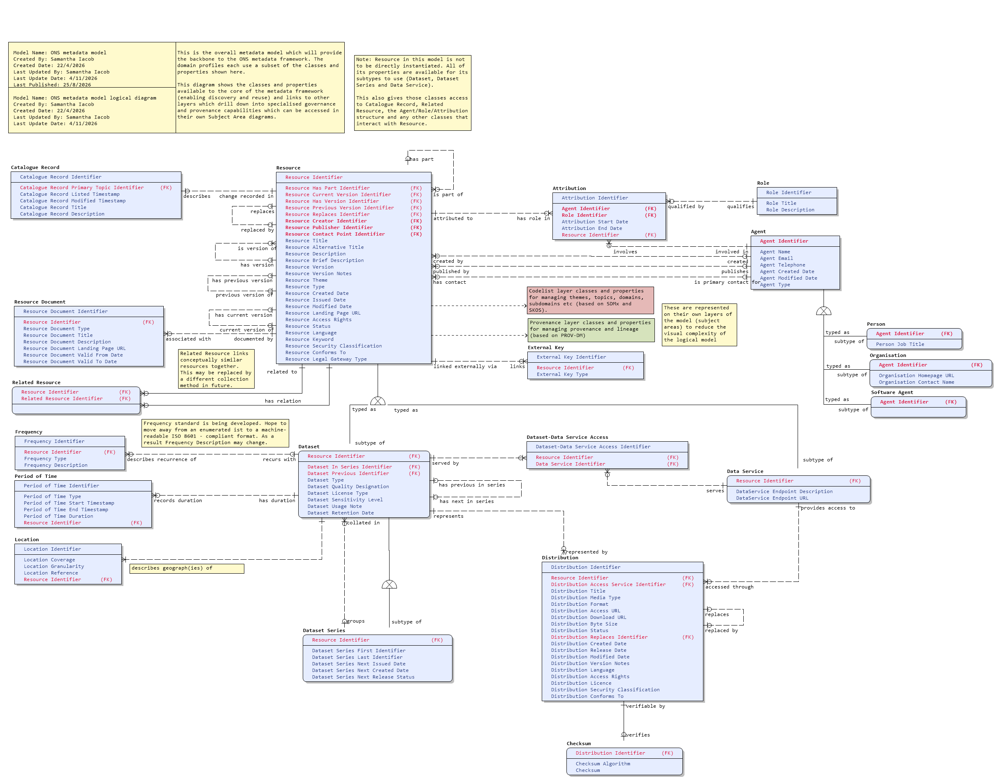
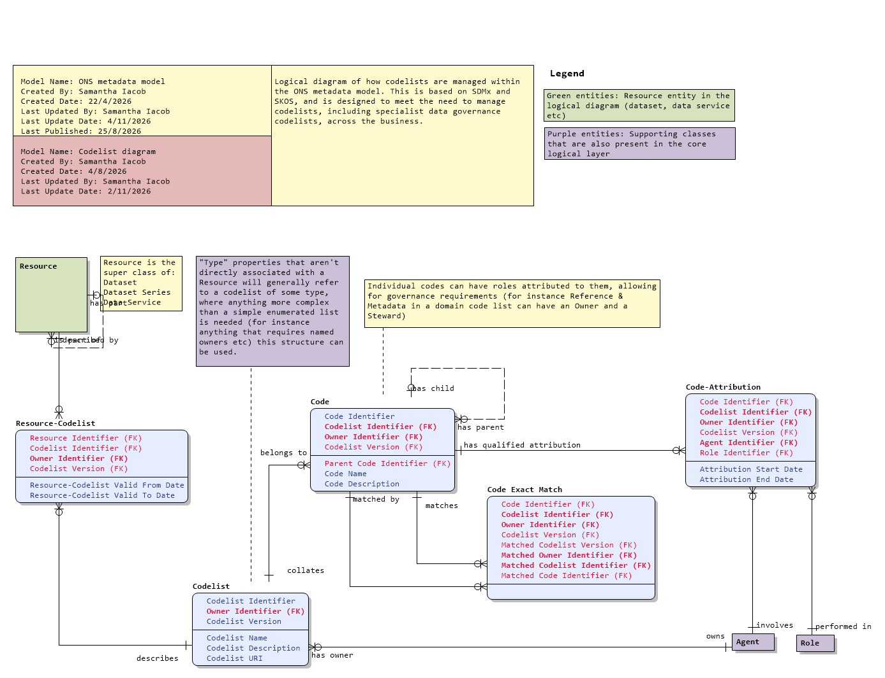
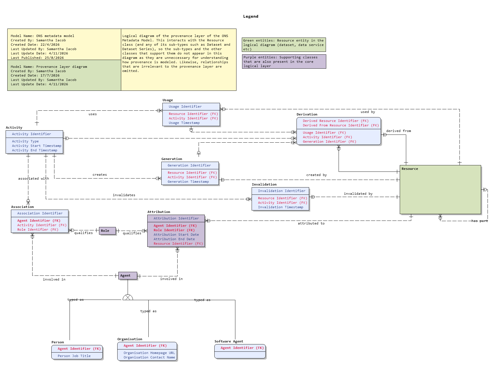

# Drafts

Please note that these diagrams are in draft form - they have not been agreed for release. They are provided so interested people can keep track of developments and input on any changes that might be coming up.

These will be updated from time to time between formal releases but probably at least fortnightly.

Latest draft is 4/11/2026

